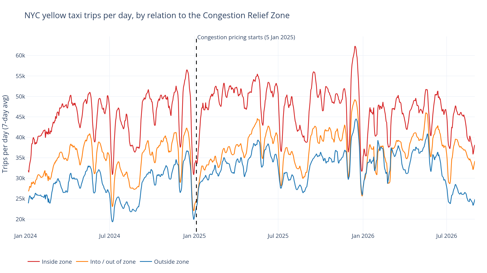
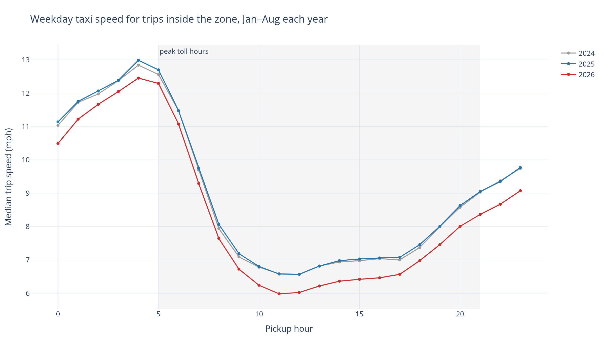
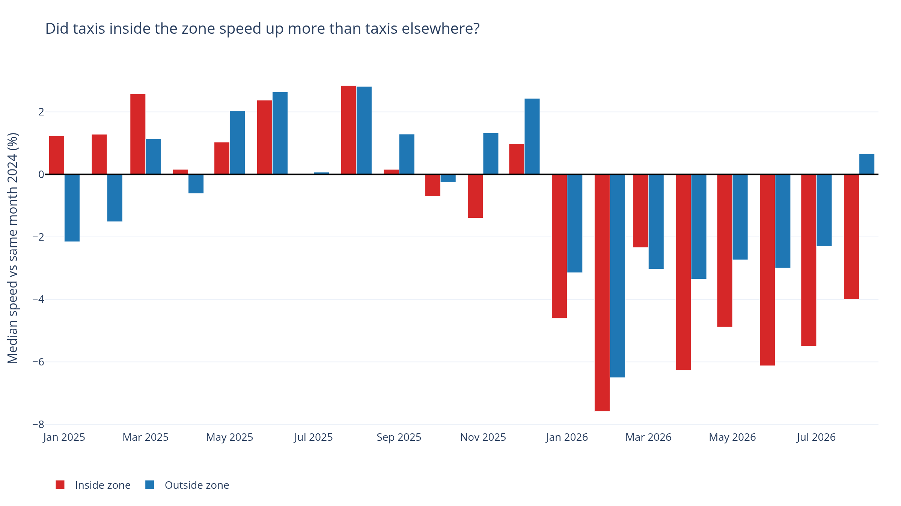
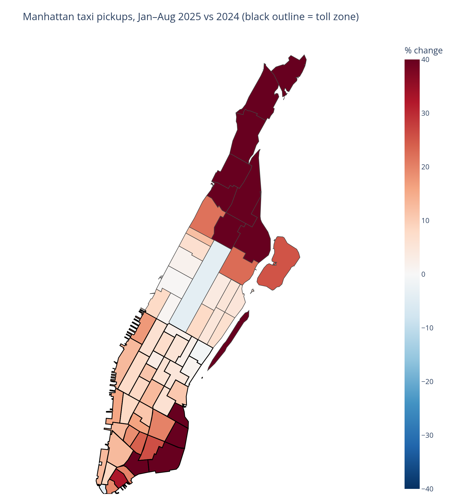
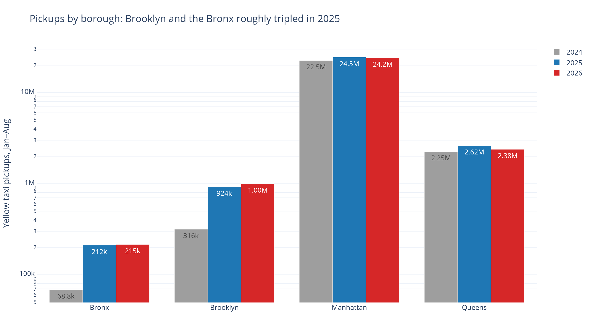
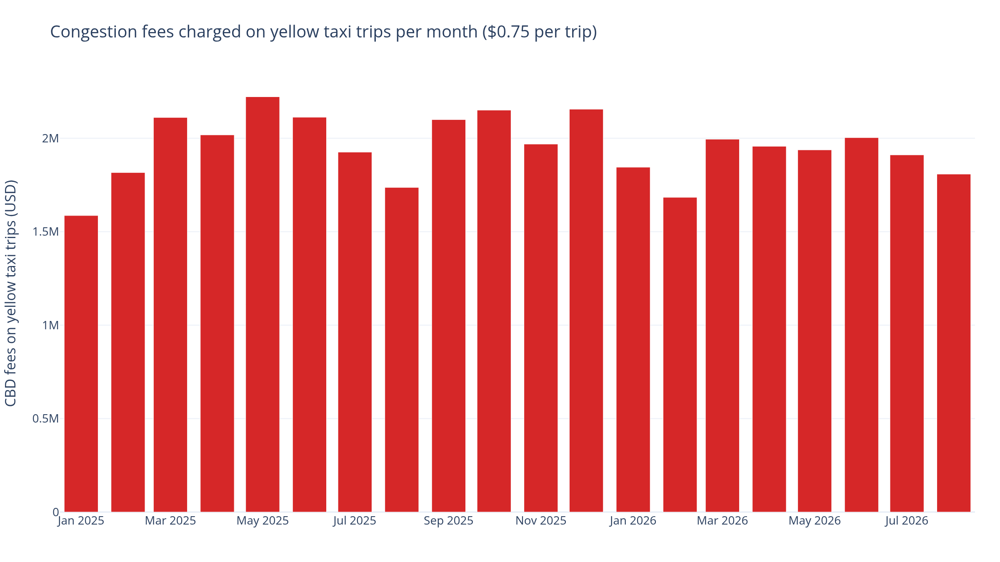

# 🚕 Did NYC's Congestion Pricing Speed Up Taxis? — 110M Yellow-Taxi Trips, 2024–2026

An interactive **Streamlit dashboard** (plus a reproducible DuckDB + Polars pipeline) that asks: *after Manhattan started charging a congestion toll on 5 January 2025, did taxi trips in the zone get faster, and did people stop taking them?*

**Stack:** DuckDB (out-of-core SQL over ~120M Parquet rows) · Polars · Plotly · Streamlit · Makefile

## Problem
New York launched the first US congestion pricing scheme on **5 Jan 2025**: vehicles entering Manhattan below 60th St pay a daily toll, and every taxi trip that touches the zone carries a **$0.75 CBD fee**. Yellow-taxi records are a classic way to measure traffic: each trip logs distance and meter time, so it doubles as a speed probe. I split trips into three groups:
- **Inside zone**: pickup and drop-off both in the toll zone
- **Into / out of zone**: one end in the zone
- **Outside zone**: neither end in the zone (a rough comparison group)

To control for seasonality, every comparison uses the **same calendar months (Jan–Aug)** in 2024, 2025 and 2026.

## Data
[**NYC Taxi & Limousine Commission – TLC Trip Record Data**](https://www.nyc.gov/site/tlc/about/tlc-trip-record-data.page): monthly yellow-taxi Parquet files (Jan 2024 – Aug 2026, **119.6M rows**, ~1.9 GB), the taxi zone lookup table and the taxi zone shapefile, all downloaded by `src/download.py`.
- Public data published by NYC TLC; see the [NYC Open Data Terms of Use](https://opendata.cityofnewyork.us/overview/#termsofuse). TLC notes the records come from technology providers and it can't guarantee their accuracy.
- Raw files are git-ignored. The committed `data/processed/` tables are tiny aggregates (under 0.6 MB in total).

## Method
1. `src/download.py` – fetch monthly Parquet files (with retries) until the latest published month.
2. `src/prepare.py` – **DuckDB** streams all files out-of-core (3 GB memory cap, ~1 minute on a laptop) and writes small aggregate Parquet tables (daily, monthly, hourly speed, zone-month, period summary). Tidy zone table in **Polars**.
   - `sql/cbd_zones.sql` – **data-driven toll-zone definition**: a taxi zone is "inside" if more than half of its same-zone trips since 5 Jan 2025 paid the CBD fee. Result: **38 Manhattan zones**, from the Financial District to Midtown; zones straddling 60th St are treated as outside.
   - `sql/clean_trips.sql` – keeps plausible trips (1–180 min, 0.1–60 mi, 1–70 mph, non-negative fare, known zones, pickup in the file's month): **110.4M trips (92.3%)**.
3. `src/geo.py` – converts the zone shapefile (NY State Plane) to a light WGS84 GeoJSON.
4. `src/analyze.py` – Polars + Plotly: headline numbers in `findings.json` and PNG charts (Kaleido).
5. `app.py` – Streamlit dashboard running DuckDB SQL on the processed Parquet.

## Key findings (Jan–Aug each year; all computed from the data, see `findings.json`)
- **Taxi demand went up, not down.** Yellow-taxi trips rose **12.4%** in 2025 (25.1M → 28.3M), then dipped **1.7%** in 2026. Trips inside the zone rose **10.4%** in 2025.
- **Speeds inside the zone barely moved.** Weekday median trip speed inside the zone was **7.91 mph in 2024 and 7.98 mph in 2025 (+0.9%)**, versus **0.0%** for trips outside the zone, so the toll-zone gain over the comparison group is less than one percentage point. Trips crossing the zone boundary did a little better (**+2.3%**).
- **2026 is slower everywhere**: inside-zone weekday speed fell to **7.47 mph (−5.6% vs 2024)**, outside-zone to 9.81 mph (−3.6%), and median inside-zone trip time grew from 11.1 to 12.0 minutes.
- **A confounder hiding in "outside":** pickups in **Brooklyn roughly tripled (316k → 924k)** and the **Bronx tripled (69k → 212k)** in 2025, while Manhattan grew 8.9%. Whatever caused that, it isn't the toll, and it means "outside the zone" is not a clean control group.
- **Riders pay a bit more:** the average weekday total for an inside-zone trip went from **$20.66 (2024) to $21.26 (2025)**, close to the $0.75 fee, and **$23.37** in 2026.
- **$23.9M in CBD fees** were charged on cleaned yellow-taxi trips in 2025, and **$15.1M** in Jan–Aug 2026.








## Dashboard
Baseline and comparison year pickers, month-range slider, weekday/weekend filter, KPI cards, daily trip trends with adjustable rolling window, speed-by-hour curves per segment, inside-vs-outside monthly speed comparison, a zone choropleth (pickups or speed change, Manhattan or all NYC), fares and fees, and a method tab with the toll-zone classification table and CSV download.

## Run it
```bash
make setup data analyze   # venv, download (~1.9 GB), aggregate, charts
make app                  # streamlit run app.py
```
The processed tables are committed, so `make setup app` alone is enough to open the dashboard without downloading the raw data.

## Limitations
- Taxi speed is a proxy for traffic; it reflects only trips taxis actually make and includes stop time at lights.
- This is a before/after comparison with a rough comparison group, not a causal estimate. Weather, events, fare changes, tourism and the outer-borough surge all move the numbers.
- January 2025 includes four days before the toll started (1–4 Jan).
- Taxi zones don't line up exactly with the 60th St boundary; straddling zones are classified as outside.
- Speeds in the app and hourly charts are trip-weighted averages of monthly medians; headline speeds are exact medians over the Jan–Aug window.
- The private-car toll itself and for-hire vehicles (Uber, Lyft) are not in this dataset.

## Licence
Code: MIT. Data: NYC Taxi & Limousine Commission trip records, published as open data.
